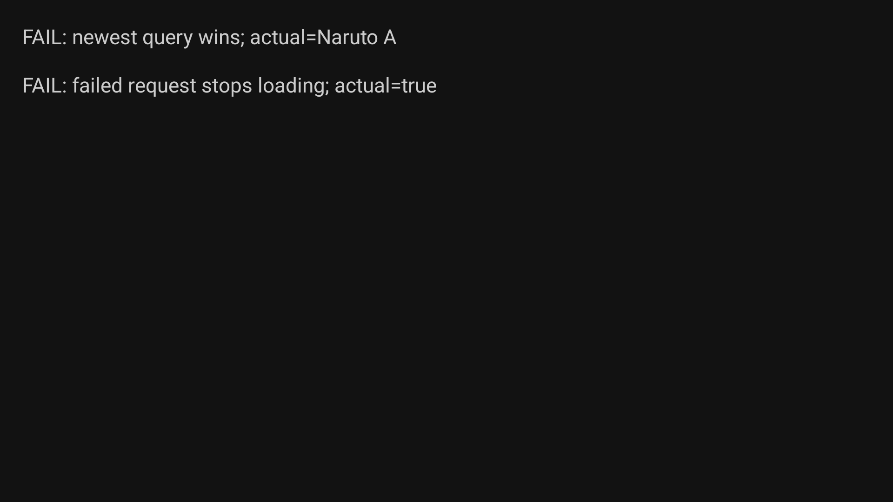
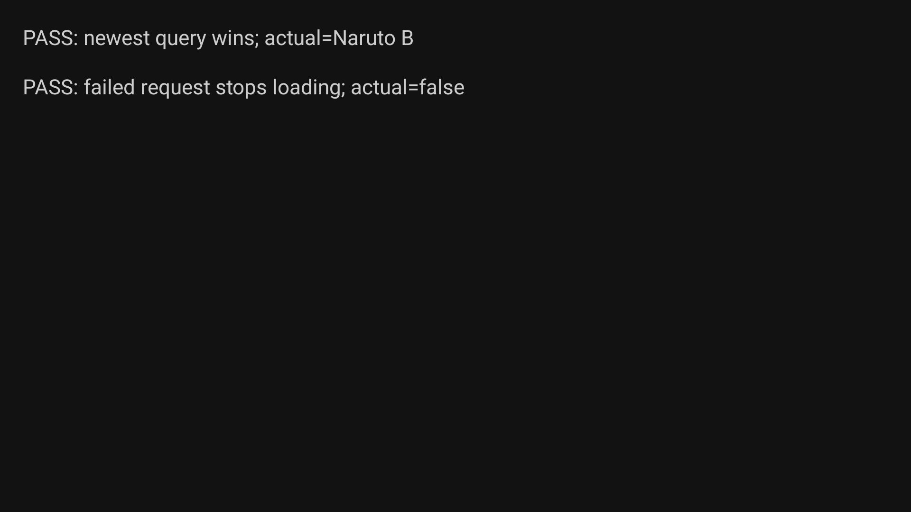

# Sozo TV — chuqur tuzatishlar

2026-09-12. Avvalgi UI tuzatishlari saqlangan. Bu bosqich qidiruv, CloudStream mosligi va player lifecycle’iga qaratildi.

## Natija

| Kamchilik | Tuzatish | Tekshiruv |
|---|---|---|
| CloudStream sahifali qidiruvni talab qiladigan pluginlarda `NotImplementedError` | Host va tavsiyalar fallback’i `search(query, 1)` dan foydalanadi; `hasNext` saqlanadi | Eski/yangi API va cancellation uchun 4 unit test; 6 haqiqiy plugin natija qaytardi |
| Plugin xatosi bo‘sh muvaffaqiyatga aylanishi | Search xatosi yuqoriga uzatiladi; repository cancellation’ni qayta tashlaydi, plugin failure’ni Result.failure qiladi | Failure/cancellation regressiya testlari |
| “All sources” faqat 12 manbani qidirishi | Standart limit olib tashlandi; 4 worker, individual timeout va incremental natijalar saqlanadi | 30 manba, takroriy id va faol manba prioriteti testlari |
| AnimePahe kutadigan instance getter o‘rniga static getter | `CommonActivity.activity` dan `@JvmStatic` olib tashlandi | JVM metod imzosi testi avval FAIL, keyin PASS; real qidiruv hali timeout |
| Eski qidiruv javobi yangi natijani bosishi | Barcha qidiruv rejimlariga bitta job, cancellation va request generation | Haqiqiy SearchViewModel bilan TV harness: A kechikadi, B oldin keladi; avval A, keyin B saqlandi |
| Xatodan keyin loading o‘chmasligi | Loading holati request egasiga bog‘langan `finally` da yopiladi | TV harness: avval true, keyin false |
| Player view yo‘q qilingandan keyin fokus crash’i | Detached view fokusni tiklamaydi; play/pause listener yo‘qolgan binding’ga murojaat qilmaydi | Oldingi crash stackidagi aniq dereference olib tashlandi, build o‘tdi; maxsus uzoq playback stress testi bajarilmadi |

## Haqiqiy CloudStream sinovi

Android TV `Sozo_TV_Audit`, `emulator-5556`, 1920×1080, API 36. `Naruto` so‘rovi, avvalgi o‘rnatilgan haqiqiy pluginlar, production `ExtensionEngine.search` orqali:

| Manba | Natija |
|---|---:|
| AllWish | 26 |
| Anikage | 25 |
| KickassAnime | 29 |
| MovieBox | 14 |
| StreamPlay | 20 |
| SuperStream | 20 |
| AnimePahe | 20 s timeout; ishlashi tasdiqlanmadi |

[Xom natijalar](cloudstream-after.jsonl). Bu qidiruv natijalari; barcha serverlardan video ijrosi ishlashi degani emas. Log fayli emulator bufferidan olingan va oldingi seans yozuvlarini ham o‘z ichiga olishi mumkin; aynan shu sinovning yakuniy natijasi JSONL’da.

## Qidiruv regressiyasi — oldin/keyin

Diagnostika haqiqiy `SearchViewModel` va cancellation’ga javob bermaydigan, kechikishni nazorat qilish mumkin bo‘lgan repository bilan bajarildi. Matnli test ekrani diagnostikaga tegishli, mahsulot UI maketi emas.

[Oldingi o‘lchov](search-before.txt), [keyingi o‘lchov](search-after.txt). Shu regressiya anime qidiruv yo‘lida real bajarildi; movie va all-sources aynan shu umumiy request boshqaruvidan foydalanadi, lekin har bir rejim almashinuvi alohida emulator testi bilan sertifikatlanmagan.

## Build va chegaralar

`./gradlew :app:assembleDebug :app:testDebugUnitTest` — 159 test, 0 failure, 0 error. 7 ta yangi unit test: 4 CloudStream search, 2 qamrov, 1 ABI. `git diff --check` toza.

Tekshiruv paytida bir cold start ANR bilan tugadi; keyingi ishga tushirish muvaffaqiyatli bo‘ldi. Bu transient startup holati bartaraf etilgan deb hisoblanmaydi.

Vaqtinchalik debug activity’lar production APK’dan olib tashlangan; qayta tekshirish uchun ularning manbalari `.txt` sifatida saqlangan. Oldingi auditdagi history metadata, Anichi/CineStream/Ksoup mosligi, QuickJS 16 KB va lint kamchiliklari bu bosqichda yopilmadi. AnimePahe uchun qo‘shimcha tarmoq/Cloudflare tekshiruvi kerak.
