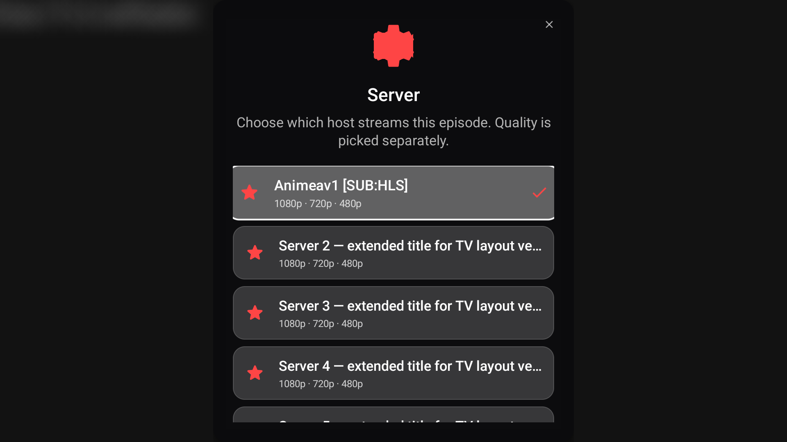
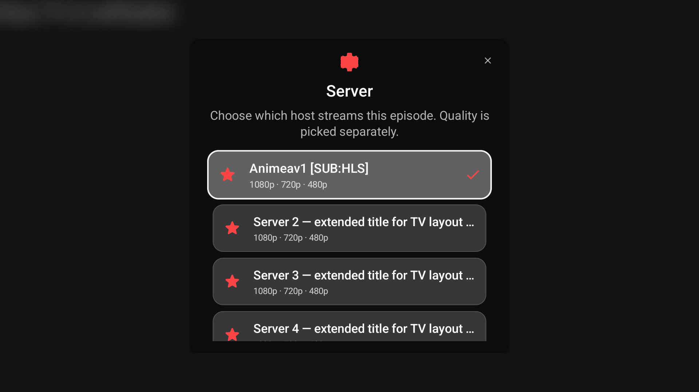
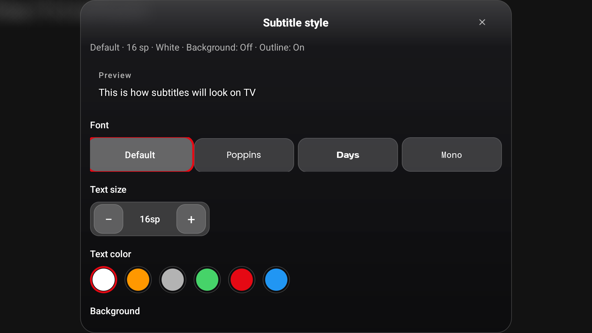
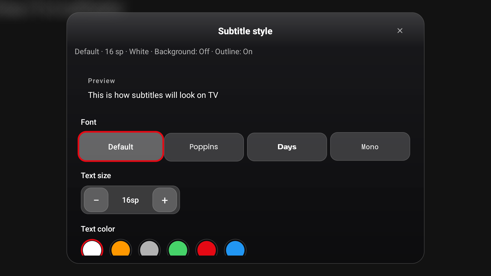

# TV UI tuzatishlari — 2026-09-12

## Tasdiqlangan sabab va tuzatish

Fokus animatsiyasi server qatorini 1.04 barobar kattalashtirar edi. Ro‘yxatda buning uchun ichki joy bo‘lmagani sababli ota konteyner yumaloq burchaklarni kesardi. Dastlabki o‘lchov: kutilgan kenglik 815.36 px, ko‘rinadigan kenglik 784 px — FAIL.

- Server, sifat, player sozlamalari va subtitr ro‘yxatlariga umumiy `TvDialogGridView` qo‘shildi: 16 dp gorizontal/8 dp vertikal fokus joyi, ekran balandligining yarmidan oshmaydigan viewport. Scroll qilinayotgan qatorlar sarlavha ustiga chizilmaydi.
- Server/sifat sarlavhasining ortiqcha balandligi qisqartirildi.
- `TvDialogLayout` subtitr va sozlamalar oynalarini ekran chetidan 24 dp xavfsiz masofada cheklaydi. Subtitr uslubi ichidagi scroll balandligi qolgan joyga moslashadi.
- Subtitr font, yoqish/o‘chirish va qidirish tugmalarining ota konteynerlaridagi fokus kesilishi tuzatildi.
- Sifat qatoridagi uzun fansub va quality matnlari ajratilgan joyda bir qator va ellipsis bilan chiqadi; SUB/DUB hamda tanlanganlik belgisi saqlanadi.

## Dalillar

**Oldin:**

**Keyin:**

**Subtitr uslubi oldin:**

**Subtitr uslubi keyin:**

Qo‘shimcha skrinshotlar: [sifat](1080p/quality.png), [sozlamalar](1080p/popup.png), [subtitr tanlash](1080p/chooser.png), [qidirish](1080p/search.png), [oxirgi server](1080p/last.png), [bitta server](1080p/single.png).

## Tekshirish usuli va qamrov

Android TV AVD `Sozo_TV_Audit`, `emulator-5556`, API 36, 1920×1080, density 320. Mobil emulator ishlatilmadi. Vaqtinchalik debug Activity haqiqiy production dialog va adapterlarni nazorat qilinadigan ro‘yxatlar bilan ochdi. Bu skrinshotlardagi serverlar UI fixture hisoblanadi; ular CloudStream tarmog‘i yoki playback ishlashini isbotlamaydi.

Fokus o‘lchovlari: [8 holat natijalari](1080p/results.txt). `getGlobalVisibleRect` natijasi animatsiyadan keyingi kenglik/balandlik bilan taqqoslandi (2 px yaxlitlash toleransi); skrinshotlar ham ko‘rildi. Birinchi va oxirgi serverlar hamda bitta elementli ro‘yxat tekshirildi. Subtitr tanlash/qidirish tekshiruvlari boshlang‘ich boshqaruvlar bilan; barcha onlayn subtitr natijalari va barcha tillar to‘liq sinovdan o‘tkazilmadi.

`./gradlew :app:assembleDebug :app:testDebugUnitTest` — 152 test, 0 failure, 0 error. `git diff --check` toza. Avvalgi umumiy auditdagi lint va CloudStream/backend muammolari ushbu UI tuzatishlari bilan yopilgan deb hisoblanmaydi. Crash bufferda oldingi auditdan qolgan `SeriesPlayerScreen.wireHints` xatosi mavjud; bu hisobot butun ilovani crash-free deb da’vo qilmaydi.

Tekshiruv Activity va manifest production APKdan chiqarildi. Qayta ishlatish uchun manbalar shu papkada `.txt` sifatida saqlangan; `check.py.txt` har ishga tushirishda eski natijani o‘chirib, yangi o‘lchovni kutadi.

Bu hisobot aniqlangan player/dialog UI xatolarini qamrab oladi. Barcha ilova ekranlari, fizik TV modellari, kattalashtirilgan fontlar va barcha rezolyutsiyalarda mutlaq xatosizlik tasdiqlanmagan.
